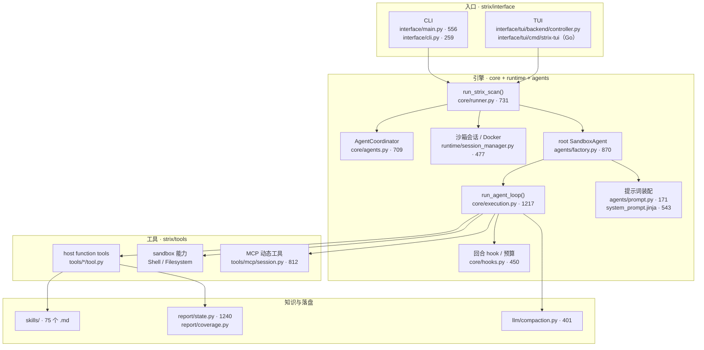
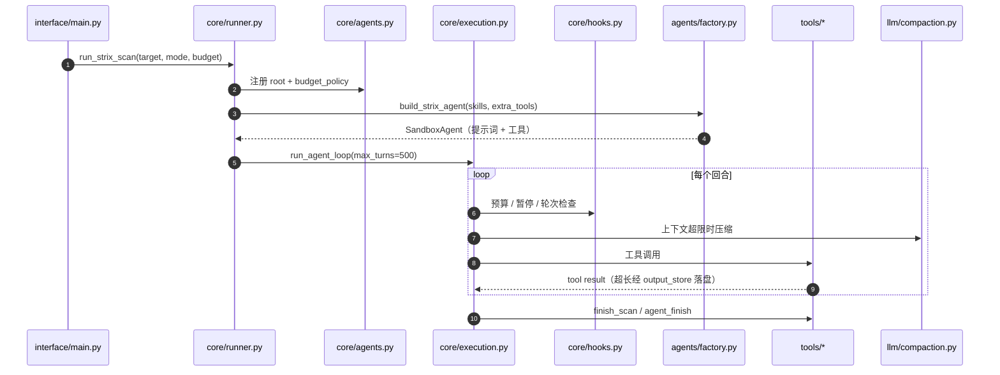
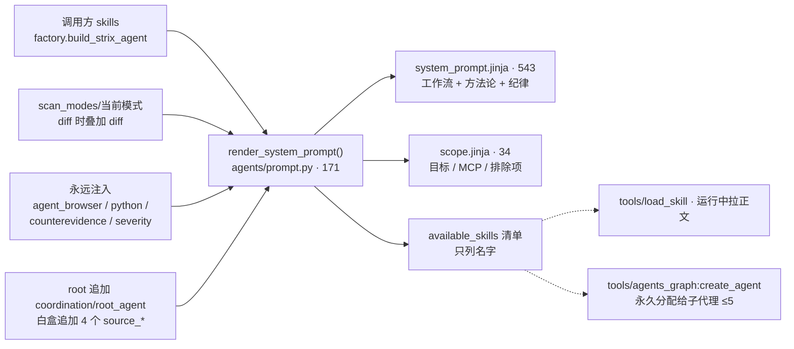
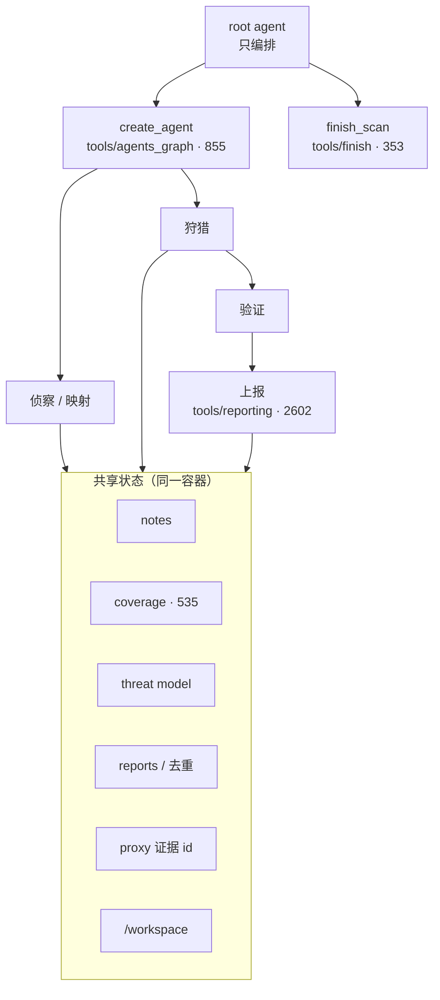

# Strix 内核架构

基线：`usestrix/strix@0601550`（2026-11-05，Apache-2.0）。文件行数为该 commit 的 raw 文件统计（含空行与注释）。

## 1. 运行时分层

代码只有三层：Agent 循环、工具集、协调器。工作流（recon → 威胁建模 → 狩猎 → 验证 → 报告 → 覆盖对账）不在这层，而在提示词与 skill 里。

## 2. 单次回合

关键不变量：**纯文本回合既不结束也不让出**，终止只能靠生命周期工具，否则循环把 Agent 推回去重跑。

| 机制 | 事实 |
|---|---|
| 轮次上限 | `DEFAULT_MAX_TURNS = 500`（`config/settings.py`） |
| 终止 | root `finish_scan`、子代理 `agent_finish`、交互式 `wait_for_user` |
| 瞬时错误 | 最多 5 次指数退避 2s→90s；401/402/403/404 不重试 |
| 上下文 | 自动压缩：保留 8k、缓冲 20k、摘要 4k |
| 预算 | `stop` 或 `pause`；子代理在 90% 处提前收手 |

## 3. 提示词装配

`scan_mode` 不是代码分支，而是 `_resolve_skills()` 决定的一份有序注入清单；`scope` 放最后以保证前缀可缓存。

## 4. 多智能体与共享状态

子代理之间不读彼此对话，靠共享状态协作。**注意**：root 不做测试只是提示词约束，代码里没有工具层 gate。

## 5. 可组合接缝

| 接缝 | 位置 | 作用范围 |
|---|---|---|
| `register_skill_dir()` | `skills/__init__.py` | 同名覆盖内置 skill |
| `register_agent_tools()` | `agents/factory.py:698` | 之后构建的所有 Agent |
| `build_strix_agent(...)` | `agents/factory.py:722` | `extra_tools` / `instructions_override` / `finish_tool` / `report_tool` / `coverage_tools` |
| `run_strix_scan(...)` | `core/runner.py:215` | `event_sink` / `status_sink` / `coordinator` |
| MCP | `~/.strix/mcp-servers.json` | 唯一运行期动态扩展 |
| CLI | `interface/cli_args.py` | `--scan-mode` / `--instruction` / `--max-budget` |

## 6. 三个容易误判的点

1. **浏览器不是 function tool**：它是沙箱内 CLI `agent-browser`，通过 `exec_command` 调用，只能在镜像层替换。
2. **`needs_approval` 只是透传**：`agents/factory.py:319` 从 `CustomTool` 继承，仓库内无工具启用，循环里也无审批中断处理。
3. **skill 不检索**：没有向量库，只有预加载、`load_skill`、`create_agent(skills=…)` 三种进入方式。
