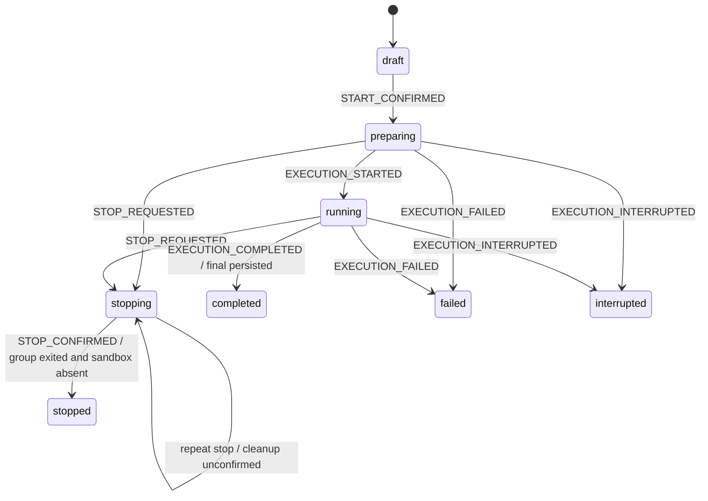

# Issue #45：Pentest 生命周期统一管理

## 基线与范围

- #44 已关闭；spawn 封装提交 `a088880`，真实停止证据提交 `1ceeb6b`。
- 真实任务 `3fe10327-0073-4b73-a3ed-965e22bf98b2` 的既有清理记录位于 `docs/verification/issue-44/`。本项开发使用模拟执行端与模拟 Docker 命令，未启动真实扫描或操作真实容器。
- #45 复用 #38／#40 的原生结果及 `readTaskResults`，最终标记以原生快照的 `final === true` 为准。
- 本项保持本机单任务规则，不增加恢复扫描、预算暂停恢复、Agent 子树控制、数据库或上游 Strix 修改。

## 状态图

`EXECUTION_PROGRESS` 只更新 preparing／running 的原因、时间与 revision。`CLEANUP_RECORDED` 保存 stopping／终态的清理观察，保持生命周期状态。终态拒绝迟到的 running 事件；所有事件核对 executionId。重复结束已经 stopped 的执行保持原有 revision。

## 模块职责

| 模块 | 责任 |
| --- | --- |
| `lib/pentest-lifecycle.ts` | 纯函数合法转换、executionId 检查、单调 revision、结构化转换错误；事件时间由调用方传入 |
| `lib/server/pentest-manager.ts` | 单实例共享的按任务保存队列、持久 worker 事件消费、执行身份检查、进程组退出与沙箱确认、启动核查与活动名额释放 |
| `lib/server/pentest-runtime.ts` | 保留公开启动、结束、Activity 读取用例；完成配置校验、受控 spawn、结束标记与管理模块调用 |
| `scripts/strix-worker.py` | 固定版本原生执行与取消；保存原生结果、Activity 事件、携带 executionId 的执行事件；不写平台 runtime，不释放活动名额 |
| `lib/server/pentests.ts` | 创建草稿、只读任务和任务列表；读取操作不探测 PID、不保存中断状态 |
| `instrumentation.ts` | Node 服务启动时启动运行管理模块，核查已保存执行；不创建、恢复或重新启动扫描 |
| `lib/server/strix-sandbox.ts` | 独立严格清理接口：按现有任务标签查询、删除、再次查询；失败与残留均返回未确认 |
| `components/platform/pentest-details.tsx` | 按 revision 和请求代次忽略旧响应；分别展示生命周期、结果完整性、清理确认；支持 stopping、重试与刷新 |

## 文件与身份契约

- `task.json`：公开配置与草稿；敏感配置继续单独加密保存。
- `runtime.json`：平台保存生命周期、revision、executionId、ownerPid、workerPid、workerPgid、sandboxId、原因、时间、清理结果及兼容字段。
- preparing 的 workerPid／workerPgid 保持为空。`launch.json` 单独记录平台实际创建的进程身份；兼容字段 runtime.pid 保留已创建的进程 PID。
- worker 继承 `PENNY_EXECUTION_ID` 与现有 `STRIX_RUN_ID`。发出信号前，通过实际进程的组号及继承执行标记核对归属；缺少身份时不发送信号。
- `execution-events.jsonl`：worker 追加的完整 JSON 行，包含 executionId、时间、阶段、执行状态、workerPid／workerPgid，以及可以取得的 sandboxId。
- `events.jsonl`：保留 Activity 的既有读取格式，worker 事件增加 executionId。
- `results.json`：保留原生结果，`final` 表达最终／部分结果；旧快照没有该字段时显示完整性未记录。
- `stop.requested`：启动交接过程中可立即观察的结束意图。准备取消后不再交付执行输入。
- `pentest-active.json`：仅平台释放；清理未确认时持续占用。

## 结束与重启核查

1. 结束请求先保存意图，再经统一转换进入 stopping。按任务串行保存，重复请求不会重新启动执行。
2. 优先通过 SIGTERM 触发适配脚本的 asyncio 取消，调用原生 runner 的清理路径；有限等待后使用 SIGKILL。
3. 确认整个进程组退出后，适配层才检查、删除并再次确认对应标签容器为空。进程组退出未确认时保持容器不变。
4. 两项确认均通过后保存 stopped，再释放活动名额。失败保存 stopping、独立清理结果与错误，页面保留重试入口。
5. completed／failed／interrupted 的清理失败可通过现有结束入口重试资源清理，保持原生命周期状态和执行错误；清理错误独立保存在 cleanup.error。
6. 启动核查会消费已有事件、确认现有执行归属、识别已退出执行，并重新核查 stopping。核查操作不产生扫描请求。
7. 旧记录的执行身份与清理信息显示未记录。无法证明归属的 PID 保持原样，活动名额保留。

## 最终结果与页面一致性

- worker 只有在最终快照保存成功后才报告 completed；平台仍使用 `readTaskResults` 重新读取并确认 `final === true`。
- worker 误报 completed、最终标记缺失、快照损坏或最终写入失败时，平台保存 failed，并保留已有部分结果与发现。
- 结果完整性显示未产生、部分、最终、读取异常及旧记录完整性未记录。读取结果异常时仍展示已保存生命周期。
- 清理结果单独显示进程组退出与沙箱清理确认；状态 completed 本身不释放尚未确认清理的活动名额。
- 页面使用单调 revision 忽略较旧响应，并保留已有请求代次保护；stopping 持续轮询，刷新后继续显示已保存状态与重试入口。

## 已确认测试边界与验证记录

- 纯状态机公开接口：合法／非法转换、executionId、revision、最终持久化保护、进度及清理观察。
- 公开任务接口：模拟执行端覆盖正常完成、准备期间结束、重复结束、迟到事件、SIGTERM 无响应、清理失败、最终写入失败、启动核查及只读查询。
- 浏览器页面：旧 revision、旧请求回写、stopping、清理重试、刷新及结果完整性独立展示。

实际命令、输出和退出状态记录在 `docs/verification/issue-45/`。模拟通过与 #44 真实沙箱证据分别保存。
